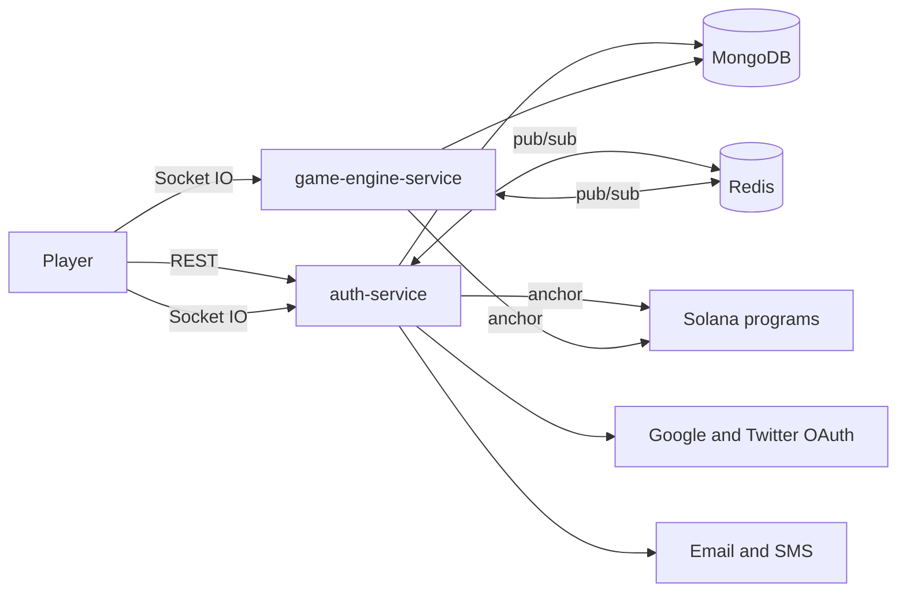

# solana-betting-backend

The backend for a Solana betting site. Players sign in, get a custodial wallet, and play provably fair games where each bet is settled through an on-chain program. It is split into two Node services that share a MongoDB database and talk through Redis.

I worked on this as part of a team, mostly on bug fixes and the audit fixes. This is a cleaned copy: the keys, env files and uploaded files are removed and the branding is generic.

## Services

| Service | Port | What it does |
|---|---|---|
| `auth-service` | 2002 | Accounts, sign-in with email, Google or Twitter, wallets, admin API, levels and reward boxes, airdrop, a token swap pool, chat |
| `game-engine-service` | 2003 | Runs the games: crash and coin flip. Places and settles bets on Solana, keeps live game state |



## What is in it

- Crash game: a rising multiplier with a live round, bets and cash-outs over Socket.IO
- Coin flip: create a game, join against it, or play the bot
- Fair results: server seed, client seed and nonce are combined and the result is seeded from that, so a player can check a round afterwards
- Bets, wins and deposits are recorded as transactions and settled on Solana with the Anchor client (devnet or mainnet by `NODE_ENV`)
- Custodial wallets: each user gets a keypair, and the private key is AES-encrypted before it is stored
- Daily reward boxes and levels, an airdrop cron job, and a token swap pool with its own contract interface
- Admin API for users, games, configuration and reports with CSV and PDF export
- Rate limiting, Helmet, input sanitising for MongoDB, httpOnly auth cookie plus JWT

## Tech stack

Node.js 22, Express, Socket.IO, MongoDB with Mongoose, Redis (ioredis), Solana web3.js, Anchor, SPL token, Babel, Passport, JWT, node-cron, ExcelJS and PDFKit.

## Running it

You need Node 22, MongoDB and Redis, plus your own Solana wallet and deployed programs (devnet is fine).

```
cd auth-service
cp Environment/.env.example Environment/.env.local   # fill in
npm install
NODE_ENV=local node babel_hook.js
```

Do the same in `game-engine-service`. The program ids, machine addresses and keys in the env files have to come from your own deployment. The contract interfaces used by the code are in `solanaContractAbi/`. The AMM program address in `amm.json` is a placeholder.

## Notes

- Several secrets (`SECRET_KEY`, `JWT_SECRET`, `WALLET_ENCRYPTION_KEY`, `SESSION_SECRET`) should be four different values. The code falls back to `SECRET_KEY` if the others are not set.
- There are no automated tests.
- This is only a backend. The player site and the admin site are separate projects and are not included.
